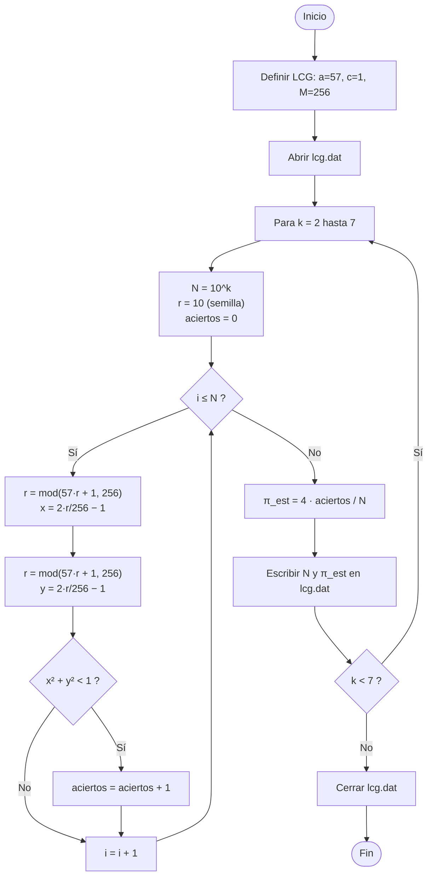

# Taller 5 — Cálculo de π y convergencia (Monte Carlo en Fortran)

**Curso:** Física Computacional (106018C)
**Estudiante:** Diego Fernando Marín Martínez
**Lenguaje:** Fortran 2008 (gfortran), con gráficas y verificación en Python

## Descripción

Se estima π por el método de acierto y error y se mide cómo disminuye el error estadístico al aumentar el número de puntos N. Además, se compara el cálculo de la integral de sin(x) en [0, π/2] (valor exacto = 1) por dos métodos, y se analiza el efecto de un generador de números aleatorios deficiente (LCG 57, 1, 256) sobre la estimación de π.

## Contenido del repositorio

| Archivo | Descripción |
|---|---|
| `TALLER5.ipynb` | Notebook de Colab con todo el taller: los tres programas en Fortran, sus resultados, la gráfica de convergencia, la interpretación y la verificación PASS/FAIL |
| `informe.pdf` | Informe de una página |
| `diagrama_flujo.png` | Diagrama de flujo de la Parte C (LCG) |

Los programas en Fortran no están como archivos separados: se escriben desde el notebook con `%%writefile` y se compilan en la propia sesión de Colab. Los archivos de datos (`.dat`) y la gráfica (`convergencia_pi.png`) se generan al ejecutar el notebook.

## Programas dentro del notebook

| Programa | Parte | Descripción | Salida |
|---|---|---|---|
| `taller5_pi.f90` | A | Convergencia de π con M = 20 corridas por cada N = 10²…10⁷ y pendiente del ajuste log-log | `convergencia.dat`, `pendiente.dat` |
| `taller5_seno.f90` | B | Integral de sin(x) por valor medio y por acierto y error (N = 1000, R = 1000) | `seno.dat` |
| `taller5_lcg.f90` | C | π con el LCG (57, 1, 256) en lugar de `random_number` | `lcg.dat` |

## Métodos

- **Acierto y error:** se lanzan N puntos uniformes en [-1, 1)²; la fracción que cae dentro del círculo unitario vale π/4, así que π ≈ 4·N_dentro/N.
- **Valor medio:** I ≈ (b − a)/N · Σ f(xᵢ), con xᵢ uniformes en [a, b).
- **Error estadístico:** σ ≈ 1.642/√N para π; la desviación se mide repitiendo el cálculo con semillas distintas.
- **LCG:** r(i+1) = (57·r(i) + 1) mod 256, con semilla r = 10; cada punto usa dos números consecutivos.

## Resultados

| Caso | Valor obtenido | Referencia |
|---|---|---|
| π, `random_number` (N = 10⁷, media de 20 corridas) | 3.141530 | 3.141593 |
| Pendiente de log10(s) vs log10(N) | −0.5079 | −0.5 |
| ∫ sin x dx, valor medio (s = 0.0153) | 0.99973 | 1 |
| ∫ sin x dx, acierto y error (s = 0.0246) | 1.00009 | 1 |
| π, LCG (N = 10⁷) | 3.093750 | 3.141593 |

**Verificación PASS/FAIL:** 5 de 5.

Conclusiones principales:
- El error estadístico decrece como 1/√N (pendiente ≈ −0.51).
- Valor medio tiene menor dispersión que acierto y error, porque usa el valor de la función en cada punto y no solo un 0 o un 1.
- Con el LCG la estimación se estanca en ≈ 3.0937 desde N = 10⁵: el generador tiene solo 256 estados, sus pares (x, y) se repiten y el error es sistemático, no estadístico.

## Diagrama de la Parte C

## Cómo ejecutar

1. Abrir `TALLER5.ipynb` en Google Colab.
2. Ejecutar las celdas en orden: cada programa tiene una celda `%%writefile` (guarda el `.f90`) y una celda de compilación y ejecución con `gfortran -std=f2008 -O2 -fcheck=all`.
3. Ejecutar la celda final de verificación PASS/FAIL.

El caso N = 10⁷ de la Parte A tarda unos segundos.

## Uso de IA

Se utilizó inteligencia artificial como herramienta de apoyo durante el desarrollo del programa. Principalmente se empleó para depurar errores de compilación y lógica, proponer mejoras en la estructura y legibilidad del código, y verificar el cumplimiento de buenas prácticas de programación en Fortran. Las sugerencias obtenidas fueron revisadas y adaptadas al código desarrollado.
